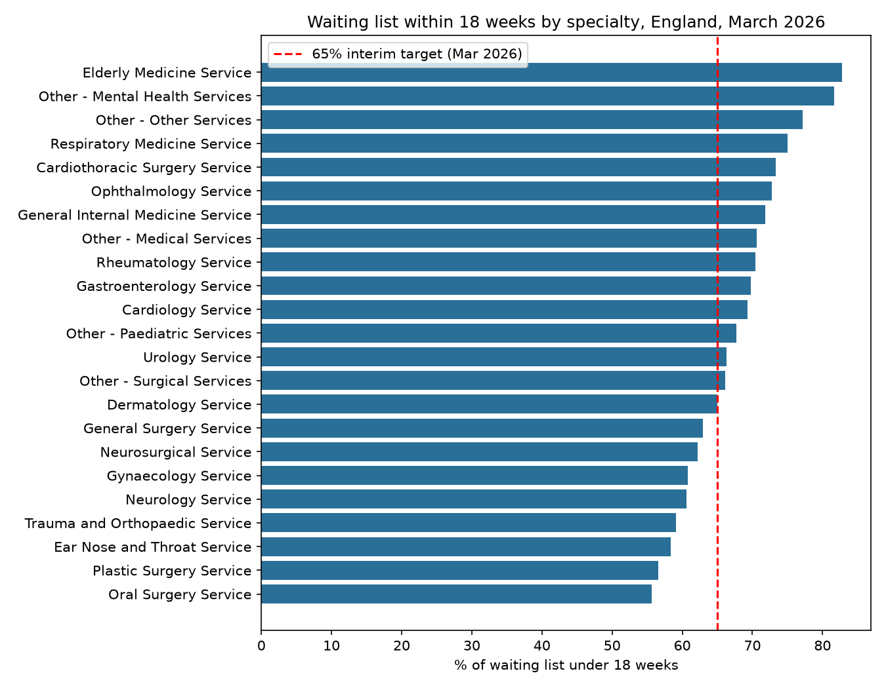
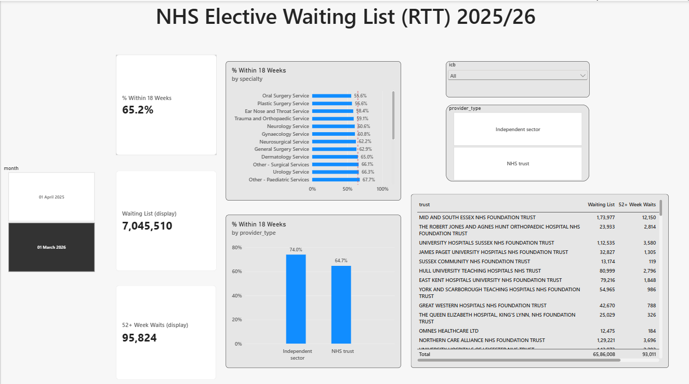

# NHS Elective Waiting List (RTT) Analysis, 2025/26

Analysis of the NHS England consultant-led Referral to Treatment (RTT) waiting list: how it changed between April 2025 and March 2026, which specialties and trusts have the longest waits, and whether the 65% interim 18-week target was met.

## Business questions

1. How large is the waiting list, and did England reach 65% of patients waiting under 18 weeks by March 2026?
2. Which specialties have the longest waits and the most 52-week waiters?
3. How did each specialty change over the year?
4. Which trusts and Integrated Care Boards (ICBs) perform best and worst?

## Data

**Real, published data:** NHS England [Consultant-led RTT Waiting Times 2025-26](https://www.england.nhs.uk/statistics/statistical-work-areas/rtt-waiting-times/rtt-data-2025-26): full CSV extracts for April 2025 (183,735 rows) and March 2026 (184,184 rows), 121 columns, with weekly waiting-time bands from 0 to 104+ weeks.

## Approach

| Step | File | What it does |
| --- | --- | --- |
| 1 | `01_explore_data.ipynb` | Inspects structure, pathway types, specialties and weekly band columns |
| 2 | `02_clean_data.ipynb` | Keeps incomplete pathways (the waiting list), fills unreported values, reconciles specialty totals against NHS England's "Total" rows, recalculates totals from the weekly bands where the published total field was blank, flags NHS vs independent sector providers, aggregates across commissioners (7,251 rows) |
| 3 | `03_analysis.ipynb` | National change, specialty performance and change, provider type, trust and ICB comparison |
| 4 | `04_sql_analysis.ipynb` | SQL cross-check, specialty comparison with conditional aggregation, trust change in 52-week waits using CTEs and an INNER JOIN |
| 5 | `rtt_dashboard.pbix` | Interactive Power BI dashboard |

## Power BI dashboard

KPI cards, specialty performance against the 65% target, NHS vs independent sector, trust table (trusts with 10,000+ patients waiting), and slicers for month, ICB and provider type. The month slicer is single-select because the waiting list is a point-in-time snapshot and must not be summed across months.

## Key findings

1. **England reached the 65% interim target by March 2026:** 65.2% of patients were waiting under 18 weeks, up from 59.7% in April 2025, but still far below the 92% standard.
2. **The waiting list fell 5.1%**, from 7.42 million to 7.05 million.
3. **52-week waits halved**, from 192,560 to 95,824.
4. **All 23 specialties improved, but 8 remain below 65%**, led by oral surgery (55.6%), plastic surgery (56.6%), ENT (58.4%) and trauma & orthopaedics (59.1%).
5. **Trauma & orthopaedics is the largest pressure point:** the biggest list (826,172) and about 20% of all 52-week waits.
6. **Long waits are highly concentrated:** one trust (Mid and South Essex, 50.6%) accounts for about 13% of England's 52-week waits.
7. **Only 59 of 128 large NHS trusts (46%) met 65%**, and the gap between ICBs is 23 percentage points (51.8% to 74.6%).
8. **Independent sector providers scored 74.0% vs 64.7% for NHS trusts**, but hold only 6% of the list and treat a different case mix, so the comparison is not like-for-like.

## Method notes

- Percentages are calculated from summed counts, not averaged across organisations.
- The published "Total" field was blank for some rows, so totals were recalculated from the 105 weekly bands and validated (weekly bands + unknown clock start = Total All, difference 0).
- Trust comparisons include NHS trusts with 10,000+ patients waiting, to avoid small providers distorting rankings.
- Provider type is derived from organisation codes (NHS trust codes begin with R or T).
- The waiting list is a snapshot, so figures are always reported per month, never summed across months.

## Limitations

- Two months only (start and end of the year), so the trend within the year isn't shown.
- Totals cover reporting providers only and may differ slightly from NHS England's headline figures, which include estimates for non-reporting trusts.
- No case-mix or clinical priority data, so differences between providers can't be fully explained.

## Tools

Python (pandas, matplotlib) · SQL (SQLite) · Power BI (DAX) · Jupyter Notebook · Git/GitHub